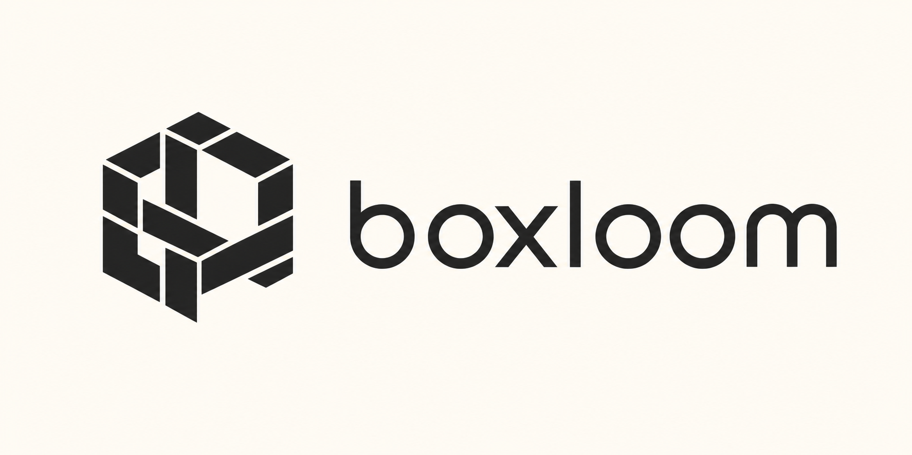

<p align="center">
  
</p>

# boxloom

boxloom connects Python programs to Minecraft Java Edition through a server-side Fabric mod.

> [!IMPORTANT]
> boxloom is an early-stage project. Its API, supported versions, and release process may change.

## Quick start

The quickest way to try boxloom is the included Docker Compose environment. It starts a Minecraft server with the boxloom mod and a browser-based editor with the local Python SDK already configured.

You need Docker and Minecraft Java Edition 26.3.

```bash
docker compose up --build
```

When the Minecraft log reports `Done`:

1. Connect Minecraft Java Edition to `localhost:25566`.
2. Open `http://localhost:8080`.
3. Run `python sample.py` in the browser-based editor's terminal.

The first startup can take a few minutes while Docker downloads and builds the required components. Stop the environment without deleting the Minecraft world with:

```bash
docker compose down
```

Ports, memory, and the local API token can be changed by copying [`.env.example`](.env.example) to `.env` and editing it.

The server uses Creative mode and Normal difficulty, so hostile mobs such as zombies
can be summoned. To use commands in Minecraft, set `MINECRAFT_OPS` in `.env` to your
Minecraft Java profile name (or a comma-separated list of names):

```dotenv
MINECRAFT_OPS=YourJavaName
```

Run `docker compose up -d` to apply changes to an existing server. Listed players
receive OP level 4, which grants access to all commands, including
`/summon minecraft:zombie ~ ~ ~`. Operator permissions are saved in the world volume.
To grant another player access while the server is running, use:

```bash
docker compose exec --user 1000 minecraft mc-send-to-console op YourJavaName
```

## Install the Python SDK

The current alpha is published on TestPyPI:

```bash
python -m pip install --index-url https://test.pypi.org/simple/ boxloom==0.1.0a10
```

Point the SDK at a running boxloom Fabric server:

```bash
export BOXLOOM_BASE_URL=http://127.0.0.1:28886
export BOXLOOM_AUTH_TOKEN=replace-me
```

The Docker Compose environment sets these values automatically inside its browser-based editor.

## Samples

Place a block:

```python
from boxloom import BlockPos, blocks, set_block

set_block(BlockPos(0, 100, 0), blocks.DIAMOND_BLOCK)
```

Python uses `BlockPos` for integer block coordinates and `Vec3` for player/entity
positions and offsets. Both support addition, subtraction, and scalar multiplication.
Convert explicitly with `position.to_block_pos()` (floor) or `block_pos.to_vec3()`
(the block's minimum corner). See the [Python SDK](sdks/python/README.md#coordinates).

Read and write block-state properties using string keys and values:

```python
from boxloom import BlockPos, blocks, get_block, set_block

set_block(BlockPos(0, 99, 0), blocks.FARMLAND, properties={"moisture": "7"})
result = set_block(BlockPos(0, 100, 0), blocks.WHEAT, properties={"age": "3"})
print(result.changed, result.properties)
print(get_block(BlockPos(0, 100, 0)).properties["age"])  # "3"
```

Properties start from the block defaults; omitted properties reset to defaults.
Reads and set results contain the complete state in a read-only mapping. Unknown
properties or invalid values return `400 INVALID_BLOCK_PROPERTY` without changing
the world. An identical state returns `changed=False`; changing a property alone
returns `changed=True`.


Give a player blocks or items, as with `/give`:

```python
from boxloom import give_item, items

give_item("Steve", items.STONE, count=64)
give_item("Steve", items.BONE_MEAL, count=3)
give_item("Steve", items.DIAMOND_SWORD)  # count defaults to 1
```

Also available as `player.give_item(item, count=1)` on a player returned by
`get_player()`. Matching stacks and free slots are chosen automatically. Counts
are limited to 100 stacks per call. Survival overflow drops at the player;
creative overflow follows vanilla and may be discarded. See the
[Python SDK reference](sdks/python/README.md) for the result and validation rules.

Give, select, and use bone meal on a plant (aim at a growing plant in Minecraft):

```python
from boxloom import get_player, items

player = get_player("Steve")
if player is not None:
    result = player.give_item(items.BONE_MEAL, 16)
    if result.slot is not None:
        player.select_slot(result.slot)
        print(player.use().used)
```

`result.slot` is the first hotbar slot that received items (`0–8`), or `None` if
none did. `result.slots` reports all destination slots and their added counts.
Items received in the main inventory or offhand must be moved to the hotbar
in Minecraft before selecting them.

Read an inclusive block region, including air and state properties:

```python
from boxloom import BlockPos, get_blocks

region = get_blocks(BlockPos(0, 64, 0), BlockPos(2, 65, 2))
print(len(region))  # 18
for block in region:
    print(block.position, block.block, block.properties)
```

Both corners are included and may be given in either order. Results start at the
minimum corner, with X changing fastest, then Y, then Z. At most 32,768 blocks
may be read per call, in one server-thread operation. Reads follow `get_block()`
behavior and may load or generate chunks. `BoxloomClient.get_blocks()` has the
same signature.

Fill an inclusive block region:

```python
from boxloom import BlockPos, blocks, fill

fill(BlockPos(0, 100, 0), BlockPos(4, 100, 4), blocks.GOLD_BLOCK)
```

Summon an entity:

```python
from boxloom import Vec3, entities, summon

summon(entities.PIG, Vec3(0, 100, 0))
```

Type `blocks.`, `entities.`, or `items.` in your editor to browse vanilla IDs with completion.
These constants are ordinary strings; namespaced strings such as `"example:custom_block"`
are also accepted for installed Mods.

Set the time to day:

```python
from boxloom import add_time, get_time, set_time

set_time("day")
set_time(6000)  # Set the clock to 6,000 total ticks.
add_time(1000)
print(get_time().ticks)
```

`set_time("day")` advances to the next day marker, matching Minecraft 26.3.
The other built-in Overworld markers are `"noon"`, `"night"`, and `"midnight"`.

Listen for player chat messages:

```python
from boxloom import watch_chat

with watch_chat() as events:
    for event in events:
        print(f"<{event.player.username}> {event.message}")
```

Runnable examples are available in [`examples/python`](examples/python).

Handle chat and player deaths through one event stream:

```python
from boxloom import watch_event

with watch_event() as events:
    for event in events:
        if event.type == "chat.message":
            print(f"<{event.player.username}> {event.message}")
        elif event.type == "player.death":
            print(f"{event.player.username} died: {event.message}")
```

Watch attack swings (including misses) with `watch_event("player.swing")`.
`"block.attack"`, `"block.use"`, and `"item.use"` observe block attack, block use,
and held-item use attempts. Action events include the player, hand, held item,
and position; block events also include the targeted block and its coordinates.
These are server-observed attempts, not confirmations of success, and require
no client-side mod. See the [action example](examples/python/watch_player_actions.py)
and the [Python SDK event reference](sdks/python/README.md).

Use `watch_event("player.death")` to receive only player deaths, including their
dimension and a `position` (`Vec3`) in Python. Both event types use `GET /v1/events`.

To keep a game running while events arrive in the background, use
`subscribe_event("player.death", callback=on_death)`. Registration waits for the
stream to be ready; callbacks then run serially on a background thread. Use a
`with` block to stop and join the receiver and surface failures. The
[`callback example`](examples/python/subscribe_event.py) prints chat messages and
player deaths as they arrive.

## Development

The repository uses [mise](https://mise.jdx.dev/) to install Java 25 and uv and to run the common development tasks.

```bash
mise install
mise run python-sync
mise run python-test
mise run python-typecheck
mise run python-check-constants
mise run python-build
mise run fabric-build
mise run docs-install
mise run docs-build
```

The Fabric mod JAR is written to `server/fabric/build/libs/`.

The Kotlin core tests use JUnit 6 (Jupiter) with `kotlin.test` assertions. From
`server`, run `./gradlew :core:test` for the unit and HTTP integration tests, or
`./gradlew :core:test --tests 'dev.boxloom.server.core.BoxloomHttpServerTest'`
to run the HTTP tests. Invalid request tables are reported as individual test
cases, and configuration tests use JUnit-managed temporary directories.
Minecraft GameTests also run as part of `build`; use `./gradlew :fabric:runGameTest`
to run only those tests.

After updating the supported Minecraft version, run `mise run python-generate-constants`
to refresh the registry snapshot and Python constants. See
[`data/minecraft/README.md`](data/minecraft/README.md) for the generation workflow.

## Documentation

Detailed user and API documentation is maintained in [`docs-site`](docs-site). The current language-neutral wire contract is in [`protocol`](protocol), and repository structure is described in [Repository layout](docs/repository-layout.md).

## License

boxloom is available under the [MIT License](LICENSE).
